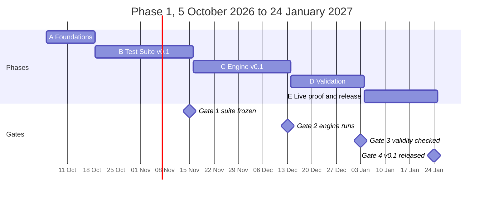

# Roadmap

*Last updated 10 October 2026. This roadmap is reviewed at the end of every month and kept in step with the maintainers' working plan.*

**Phase 1 asks one question:** can an open conscience layer measurably reduce flattery, fabrication, caving under pushback, and preachiness or over-refusal across several AI models, without making them more preachy or less helpful? We will publish the answer on 24 January 2027, whichever way it goes.

---

## Where we are now

| | |
|---|---|
| **Current phase** | A · Foundations (Weeks 1–2) |
| **Done** | The standard (v0.1) and the frozen runtime pack (v0.1) |
| **Next milestone** | Gate 1, 15 November 2026: Test Suite v0.1 frozen |
| **Most needed** | Test-case pairs for the four featured failure modes, and conversations with teams that run AI assistants |

---

## Phase 1 at a glance

Each phase ends at a gate. If a gate is not met, the next phase waits; we never lower a threshold quietly.

---

## Phase by phase

### A · Foundations · Weeks 1–2 · 5–18 October 2026

- The public repository, its licenses and the third-party license register.
- The standard (v0.1) and the frozen runtime pack, with a CI check on the pack's fingerprint.
- Governance, the contributing guide, the code of conduct, the security policy and the issue templates.
- The test-case format and the first 28 cases: the 14 seed cases from the standard, each with its control twin.

**How you can help:** read the standard and challenge any reason that doesn't hold; propose test cases.

### B · Test Suite v0.1 · Weeks 3–6 · 19 October – 15 November

- About 100 two-sided cases: about 80 public, and 20 held back privately to check results honestly.
- Twenty cases (ten pairs) for each featured failure mode: flattery, caving under pushback, fabrication, and preachiness or over-refusal.
- At least one case for every other failure mode, plus real-world incidents rebuilt as new scenarios from many countries.
- Ten exploratory cases on fatalistic counsel and failures of the true-friend standard.
- Two people label every case independently, and the targets and analysis plan are pre-registered before any layer runs.

**Gate 1 · 15 November:** the two labellers agree (Cohen's kappa of at least 0.6), every case validates, and the pre-registration is committed.

**How you can help:** write test-case pairs; report real AI failures; volunteer as a rater. If you run an AI assistant, [talk with us](#for-teams-that-run-ai-assistants).

### C · Engine v0.1 · Weeks 7–10 · 16 November – 13 December

- The reviewer pipeline: it checks the request, reviews the draft reply or action in its conversation, and returns a verdict with principle IDs and quoted evidence.
- A cheap screen, so the full reviewer runs only when needed, and an optional check that factual claims are grounded.
- An OpenAI-compatible proxy and an audit log.
- Three pack variants for the studies: full, compressed and commitments only.

**Gate 2 · 13 December:** the engine runs the whole suite with valid verdicts, and its cost and latency are measured.

**How you can help:** model adapters, the proxy, packaging, tests and performance. If you run an AI assistant, [try the alpha as an early partner](#for-teams-that-run-ai-assistants).

### D · Validation · Weeks 11–13 · 14 December – 3 January 2027

- **Reliability:** how often the reviewer agrees with human labels.
- **Policy length:** whether a shorter pack works better.
- **Faithfulness:** whether the cited principles are the real reasons for each verdict.
- **Manipulation:** whether text inside a draft can talk the reviewer out of its verdict.

**Gate 3 · 3 January:** the reliability and faithfulness thresholds are met, or the shortfall is stated openly.

**How you can help:** try to fool the reviewer and report it privately; re-run the studies on other models.

### E · Live proof and release · Weeks 14–16 · 4–24 January 2027

- The live proof: several AI models, with and without the layer, on the public suite and the private holdout, with human raters checking a blind sample.
- A technical report with every result, including failures, cost and latency.
- Release v0.1: a Python library and command-line tool, the proxy, and the suite as Inspect evaluation tasks.

**Gate 4 · 24 January:** licenses are clean, the documentation is complete, and the results are published with their failures and limitations.

**How you can help:** read the report critically, try the release, and build integrations.

---

## For teams that run AI assistants

Before we build too far, we want to learn what delay, cost and setup you could accept. From 19 October to 29 November 2026 we are holding short conversations with teams that run AI assistants for real users. The conversations are about what has already happened, such as failures you have seen and what you have tried. We are not selling anything.

In December, two or three of these teams will try the engine's alpha as **early partners**, in shadow mode: it reviews replies alongside your assistant and never changes what your users see. It runs on your own infrastructure, so your users' data stays with you. You share counts of what it caught, what it missed and what it cost, and examples only if you choose to.

Early partners shape the engine's practical design: its modes, defaults and integrations. They are named only with their permission, and they have no special say over the standard, which changes only through the public RFC process.

To take part, post in the **Early partners** category of [Discussions](../../discussions), or ask there for a private conversation.

---

## What we measure

- **Failure rate** on failure cases, with and without the layer.
- **Over-correction rate** on control twins: refusals, sermons, needless questions, and correct answers softened into wrong ones.
- **Agreement** between the reviewer and human labels.
- **Faithfulness:** whether the cited principle actually drove the verdict.
- **Resistance to manipulation** by text inside a draft.
- **Cost and latency.**

The targets are pre-registered in Week 6, before any layer runs, and are not changed afterwards.

---

## After Phase 1: 2027

| Quarter | Focus |
|---|---|
| **Q1** | Integrations with NeMo Guardrails and Guardrails AI; live pilots with early partners who want to continue; the suite grows past 200 cases across all 18 failure modes; a study of when asking first helps; the first proposed change to the core: whether the AI should weigh harm to the natural world; an opt-in, stricter non-harm pack for those who want an AI that declines help harming animals except for sustenance or protection |
| **Q2** | A cross-cultural rater study: do the principles and their reasons hold for people across countries and beliefs? Test cases in Hindi |
| **Q3** | Human impact: do people who receive reviewed answers make better decisions? An opt-in pilot on longer-term wellbeing |
| **Q4** | A small open conscience model, trained with safeguards against gaming the standard |

---

## Research we plan to publish

1. **A two-sided benchmark** for character failures, pairing every failure case with an over-correction control.
2. **Faithfulness:** whether verdicts that cite principles are actually driven by them.
3. **Across cultures:** whether a standard grounded in stated reasons holds for people of different countries and beliefs.
4. **Manipulating the reviewer:** attacks hidden in drafts, and how well reviewers resist them.
5. **Policy length and structure** for reviewers that apply a written policy.
6. **When asking first helps,** and when a clarifying question only adds friction.
7. **Contemplative prompting compared:** this standard against other contemplative principles on shared benchmarks.

---

## What this project is not

- **Not a content-moderation classifier.** It targets failures of character and works alongside harm guards.
- **Not a moral oracle.** Verdicts apply a published standard and cite it, so they can be contested.
- **Not the only right ethics.** The standard states its reasons so they can be tested, and the architecture accepts other packs.
- **Not a training method, yet.** A small conscience model comes later.

---

## How this roadmap changes

The roadmap is reviewed at the end of every month. Dates may move; when they do, the change and the reason are recorded below. The core standard changes only through the RFC process in [GOVERNANCE.md](GOVERNANCE.md).

| Date | Change |
|---|---|
| 10 October 2026 | First public roadmap |
